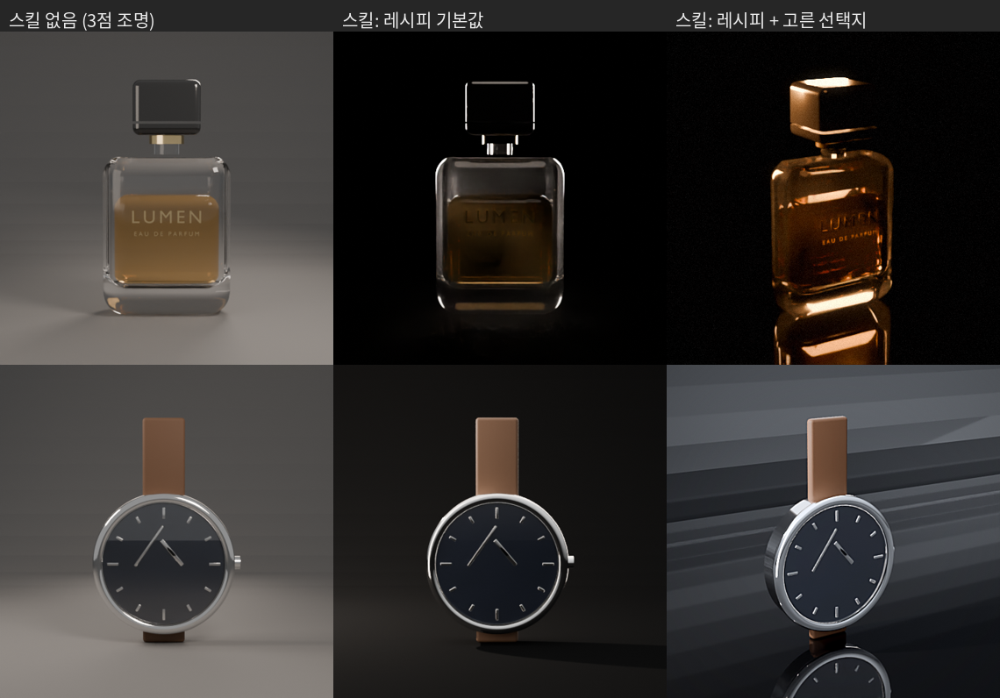
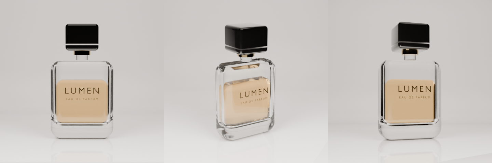

# Renderlight

**"고급스러운 향수 광고 느낌"이라고 말하면, AI가 내 Blender 씬에 제품 조명을 잡아줍니다.**
조명 셋업은 검증된 레시피에서 나오고, 선택지마다 Cycles 미리보기를 보고 고르기만 하면 됩니다. 숫자(각도·와트·켈빈)는 묻지 않습니다.

## 어떻게 쓰나

Claude 같은 AI에 [`skills/renderlight`](skills/renderlight/) 스킬을 넣고, Blender를 연결(Blender MCP)한 다음 말로 요청합니다.

1. 씬을 읽고 제품을 찾습니다 (선택한 오브젝트 우선).
2. 요청에 맞는 레시피를 고릅니다: 다크필드 유리, 브라이트필드 유리, 광택 테크 제품, 주얼리.
3. 바닥·톤·윤곽 폭·카메라 각도·심도·색보정을 하나씩 묻고, 선택지마다 미리보기 타일을 Blender 이미지 에디터와 채팅에 띄웁니다.
4. 최종 렌더 후 레시피의 체크 항목(배경 밝기, 날아간 픽셀 등)을 숫자로 확인합니다.
5. 내 씬은 망가지지 않습니다. 내 월드·카메라·라이트·렌더 설정은 저장했다가 `rl_remove()` 한 번으로 그대로 돌아옵니다.

## 폴더

- `skills/renderlight/`: 스킬 본체 (SKILL.md, 레시피 카탈로그, Blender 안에서 도는 `renderlight.py`)
- `tools/`: 레시피 검증용 테스트 하네스 (빈 씬에서 테스트 모델로 렌더)
- `blender/`: 이전 버전의 34가지 이름 있는 조명 프리셋 스킬 (인물·무드 조명)
- 웹앱(`src/`): 실험용 브라우저 라이트 볼. 현재 보류

## English

Say what the shot should feel like ("luxury perfume ad"). The `skills/renderlight` skill lets an AI with a Blender connection pick a verified studio recipe, ask you each choice with instant Cycles preview tiles, render, and check the result against the recipe's measurable checks. Your scene is restored exactly by `rl_remove()`.

## License

MIT
