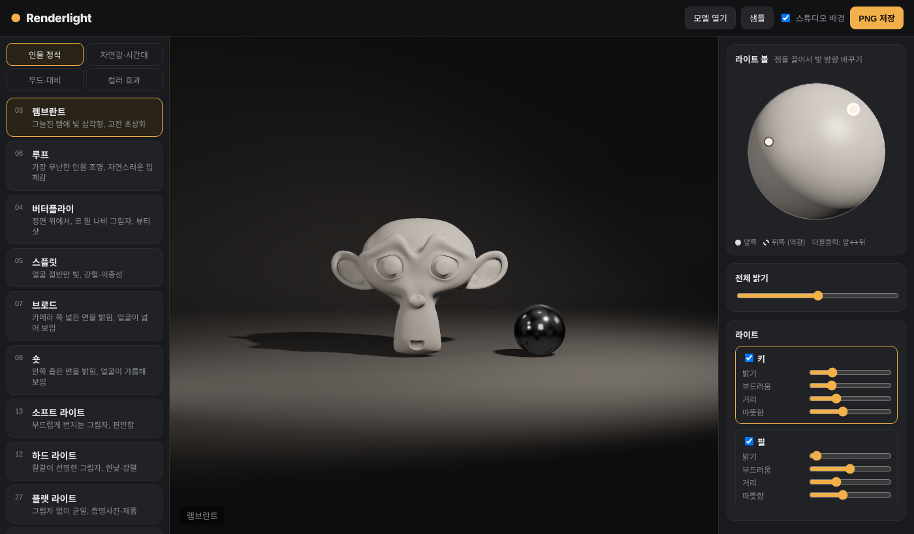

# Renderlight

**숫자 없이 조명 잡기.** 3D 모델을 올리고, 이름으로 조명을 고르고, 공 위의 점을 끌어서 빛 방향을 바꾸세요. 각도나 감마 값은 몰라도 됩니다.



## 지금 되는 것 (v0.1)

- **34가지 조명 프리셋**: 렘브란트, 버터플라이, 골든아워, 네온, 베니션 블라인드, 볼류메트릭, 스포트라이트… 인물 정석 / 자연광·시간대 / 무드·대비 / 컬러·효과 네 그룹으로 정리
- **라이트 볼**: 모델에 실제로 비치는 빛이 공에 그대로 보입니다. 점을 끌면 그 방향으로 빛이 옮겨가고, 공 테두리 밖으로 끌면 피사체 뒤쪽(역광)으로 넘어갑니다. 더블클릭하면 앞↔뒤 전환
- **쉬운 말 슬라이더**: 밝기 · 부드러움 · 거리 · 따뜻함
- **GLB / glTF 드래그 앤 드롭**, 스튜디오 배경(사이클로라마) on/off, PNG 저장
- 설치 없이 브라우저에서 동작 (Three.js)

## 로컬 실행

```bash
npm install
npm run dev
```

## 로드맵

1. ~~GLB 불러오기 + 34개 프리셋 + 라이트 볼~~ ✅
2. **변형 그리드**: 지금 조명 주변으로 9개 변형을 썸네일로 보여주고, 클릭해서 고르는 걸 반복하며 원하는 조명에 수렴
3. **느낌 슬라이더**: "부드러움 ↔ 드라마틱", "평면 ↔ 입체"처럼 여러 값을 한 번에 움직이는 슬라이더
4. **하이라이트 찍기 + 고품질 렌더**: 모델에서 빛이 닿을 곳을 클릭하면 라이트 배치, 패스트레이싱 렌더
5. **Blender로 내보내기**: 잡은 조명을 그대로 Blender에서 재현

## 조명 문법

[`docs/lighting-grammar.md`](docs/lighting-grammar.md): AI가 "고급스러운 향수 광고" 같은 말을 조명으로 바꿀 때 쓰는 규칙집이에요. 규칙마다 무료로 볼 수 있는 논문 출처와 근거 수준(실험 / 실무 관습 / 그래픽스 지표 / 우리 해석)을 붙였어요.

## Blender 스킬

[`blender/`](blender/) 폴더에는 같은 34개 프리셋을 Blender에서 만드는 Claude 스킬과 Python 헬퍼가 있습니다. 좌표계가 같아서, 웹에서 잡은 조명을 나중에 Blender로 가져갈 때 그대로 씁니다 (로드맵 5단계). 사용법은 [blender/README.md](blender/README.md) 참고.

---

## English

**Light a 3D model without touching numbers.** Drop in a GLB, pick a named lighting setup (34 presets: Rembrandt, golden hour, neon, venetian blinds, volumetric…), then drag the dots on the *light ball*, a sphere shaded by your actual lights, to move them. Drag past the rim to move a light behind the subject. Sliders use plain words (brightness, softness, distance, warmth) instead of angles and units.

Runs in the browser with Three.js. `npm install && npm run dev` to run locally.

The [`blender/`](blender/) folder contains the matching Claude skill + Python helpers that build the same 34 presets in Blender, in the same coordinate system.

## License

MIT
