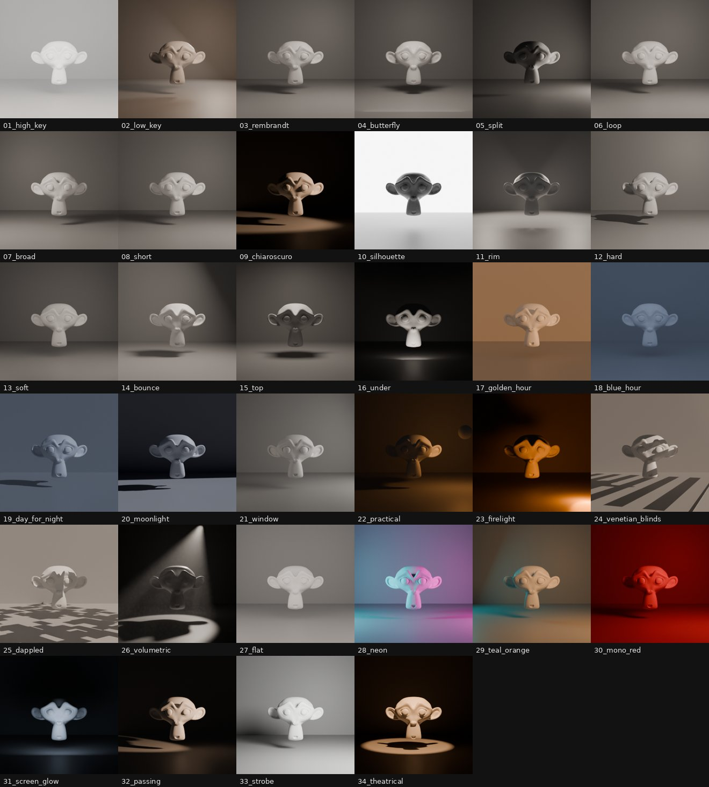

# Blender Lighting Presets

**34가지 시네마틱 조명을 이름 하나로 Blender에 세팅하는 Claude 스킬 + Python 헬퍼**
*34 named cinematic lighting setups for Blender, as a Claude skill and plain Python.*



"렘브란트로 해줘", "골든아워에 림 라이트 추가해줘"처럼 말하면, 피사체와 카메라 위치를 기준으로 라이트를 배치해 줍니다. 씬 크기나 카메라 각도가 달라도 같은 프리셋은 같은 느낌으로 나옵니다.

## 특징

- **34개 프리셋**: 렘브란트·버터플라이·루프 같은 인물 패턴부터 골든아워, 네온, 베니션 블라인드, 볼류메트릭까지
- **피사체·카메라 기준 좌표**: "카메라 기준 오른쪽 45°, 위 40°"처럼 정의돼 있어서 씬이 바뀌어도 그대로 쓸 수 있음
- **비파괴**: 기존 라이트는 지우지 않고 숨기기만 하고, `lt_restore()` 한 번이면 원래대로 돌아감
- **조합 가능**: `["rembrandt", "golden_hour", "rim"]`처럼 겹치면 패턴은 유지하고 색과 무드만 덮어씀
- **바닥·벽 자동 회피**: 라이트 경로가 막히면 자동으로 앞으로 당김 (언더 라이트가 바닥 밑으로 들어가는 문제 등)
- **세기 보정**: `ratio=1` = SUN strength 3과 같은 조도 (Cycles에서 실측)
- **AI가 질문으로 선택지를 줌**: 조명을 멋대로 정하지 않고 "어떤 느낌으로 할까?"를 객관식으로 물어봄. 분위기를 말하면("무서운 느낌", "사이버펑크") 맞는 후보 4개를 추리고, 후보를 작게 렌더해서 나란히 보여준 다음 고르게 할 수도 있음
- **애니메이션 프리셋**: 불꽃 깜빡임, 스트로브, 지나가는 빛은 드라이버/키프레임이라 Python auto-run 없이 동작

## 설치

### Claude (Claude Code / claude.ai)

`skills/blender-lighting-presets/` 폴더를 스킬로 추가하세요.

- **Claude Code**: `~/.claude/skills/` 또는 프로젝트의 `.claude/skills/`에 폴더째 복사
- **claude.ai**: 폴더를 zip으로 묶어서 스킬 설정 화면에서 업로드

Blender 연결도 필요합니다. Python 실행이 되는 Blender MCP 서버(예: `execute_blender_code` 도구가 있는 것)를 연결한 뒤 이렇게 말하면 됩니다:

> 머리 메시에 렘브란트 조명 잡아줘
> 골든아워로 바꾸고 림 라이트 추가해줘
> 원래 조명으로 돌려줘

대화 예시:

> **나**: 조명 좀 무서운 느낌으로 잡아줘
> **Claude**: 어떤 조명으로 할까? [언더 라이트] [탑 라이트] [키아로스쿠로] [로우키] ← 미리보기 렌더와 함께
> **나**: 언더
> **Claude**: (세팅 후 렌더 확인) 림 라이트나 안개도 추가할까?

### ChatGPT / Codex / 다른 AI

`SKILL.md`는 그냥 마크다운이라 어떤 AI든 지침으로 쓸 수 있습니다. 질문 도구가 없는 환경에서는 번호 목록으로 물어보도록 적혀 있어요. Blender에서 Python을 실행할 수 있는 연결(MCP 등)만 있으면 됩니다.

### Claude 없이 Blender에서 직접

1. Scripting 탭에서 `lt_helpers.py`와 `lt_presets.py`를 열기 (Text → Open)
2. Python Console에서:

```python
exec(bpy.data.texts["lt_helpers.py"].as_string())
exec(bpy.data.texts["lt_presets.py"].as_string())

apply_preset("rembrandt", subject="Head")
apply_preset(["rembrandt", "golden_hour", "rim"], subject="Head")
apply_preset("렘브란트", subject="Head")   # 한국어 이름이나 번호("03")도 됨
lt_restore()                               # 원래대로

choices(mood="cyberpunk")                  # 분위기에 맞는 후보 4개
lt_preview(["neon", "teal_orange", "screen_glow"], subject="Head")  # 후보 미리보기 렌더
```

## 프리셋 목록

| # | id | 이름 | # | id | 이름 |
|---|---|---|---|---|---|
| 01 | `high_key` | 하이키 | 18 | `blue_hour` | 블루 아워 |
| 02 | `low_key` | 로우키 | 19 | `day_for_night` | 데이 포 나이트 |
| 03 | `rembrandt` | 렘브란트 | 20 | `moonlight` | 문라이트 |
| 04 | `butterfly` | 버터플라이 | 21 | `window` | 윈도우 라이트 |
| 05 | `split` | 스플릿 | 22 | `practical` | 프랙티컬 |
| 06 | `loop` | 루프 | 23 | `firelight` | 파이어라이트 |
| 07 | `broad` | 브로드 | 24 | `venetian_blinds` | 베니션 블라인드 |
| 08 | `short` | 숏 | 25 | `dappled` | 대플드 |
| 09 | `chiaroscuro` | 키아로스쿠로 | 26 | `volumetric` | 볼류메트릭 |
| 10 | `silhouette` | 실루엣 | 27 | `flat` | 플랫 라이트 |
| 11 | `rim` | 림 라이트 | 28 | `neon` | 네온 |
| 12 | `hard` | 하드 라이트 | 29 | `teal_orange` | 틸 앤 오렌지 |
| 13 | `soft` | 소프트 라이트 | 30 | `mono_red` | 모노크롬 레드 |
| 14 | `bounce` | 바운스 | 31 | `screen_glow` | 스크린 글로우 |
| 15 | `top` | 탑 라이트 | 32 | `passing` | 패싱 라이트 |
| 16 | `under` | 언더 라이트 | 33 | `strobe` | 스트로브 |
| 17 | `golden_hour` | 골든 아워 | 34 | `theatrical` | 시어트리컬 라이트 |

각 프리셋이 렌더에서 어떻게 보여야 하는지(체크포인트)와 커스텀 셋업 만드는 법은 [SKILL.md](skills/blender-lighting-presets/SKILL.md)에 있습니다.

## 좌표 규칙

```python
ctx = lt_setup("custom", subject="Head")
lt_light(ctx, "Key", az=50, el=35, ratio=1.0, size=0.4, kelvin=4300)
lt_light(ctx, "Rim", az=-150, el=30, ratio=1.5, size=0.2, color=(0.3, 0.6, 1.0))
lt_world(strength=0.01)
```

- `az`: 0 = 카메라 쪽, +90 = 카메라 기준 오른쪽, 180 = 피사체 뒤
- `el`: 피사체 중심 기준 높이각 (0 = 눈높이, 90 = 정수리, 음수 = 아래)
- `dist`, `size`: 피사체 바운딩박스 대각선의 배수 (SUN의 `size`는 각도°)
- `ratio`: 키 대비 밝기. 거리와 라이트 타입 차이는 자동 보정

## 렌더 팁

- 고보(블라인드, 나뭇잎), 볼류메트릭, 바운스는 **Cycles** 권장
- EEVEE는 Raytracing, Volumetrics, Soft shadows를 켜야 비슷하게 나옴
- 값은 출발점일 뿐이니 렌더를 보고 조절하세요. 전체 밝기는 라이트보다 `Exposure`로 먼저 맞추는 게 편합니다

## 테스트

모든 프리셋을 테스트 씬에서 렌더해서 위 갤러리를 다시 만들 수 있습니다 (Blender 5.x, `pip install bpy`):

```bash
python tools/render_gallery.py skills/blender-lighting-presets/scripts ./gallery 256 48
```

---

## English

A Claude skill plus plain Python helpers that build **34 named cinematic lighting setups** in Blender, positioned relative to your subject and active camera, so a preset looks consistent at any scene scale.

- **Install (Claude)**: copy `skills/blender-lighting-presets/` into `~/.claude/skills/` (Claude Code) or zip and upload it as a skill on claude.ai. Connect a Blender MCP server that can run Python, then ask e.g. *"Give the head a Rembrandt setup, then make it golden hour with a rim light."*
- **Use without Claude**: open both scripts in Blender's Text Editor, then in the Python Console run the two `exec(...)` lines above and call `apply_preset("rembrandt", subject="Head")`.
- **Non-destructive**: lights go into an `LT_<preset>` collection, existing lights are hidden (not deleted), and `lt_restore()` undoes everything.
- **Asks instead of guessing**: the skill tells the AI to offer choices as a multiple-choice question (or a numbered list where no question tool exists). Describe a mood and it narrows to 4 matching presets; `lt_preview()` can render small previews of each so you pick by eye.
- **Works beyond Claude**: SKILL.md is plain markdown, so ChatGPT/Codex or any agent with a Python connection to Blender can follow it.
- **Stacking**: `apply_preset(["rembrandt", "golden_hour", "rim"])` keeps the pattern's geometry and recolors it with the mood.
- **Calibrated**: `ratio=1` ≈ the irradiance of a SUN at strength 3 in Cycles. Lights blocked by floors or walls are moved closer automatically.

Tested on Blender 5.3 (Cycles). Gallery renders use Suzanne, so face patterns (Rembrandt vs. loop vs. short) read less clearly than on a real head.

## License

MIT
